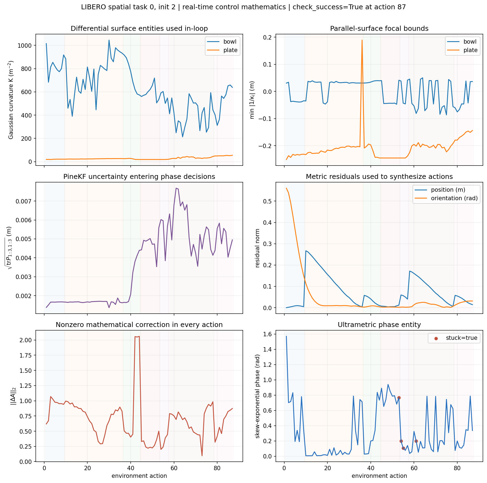

# Aletheia Compass Robotics

**Real-time neuro-geometric control, model-generated mathematical operators, and executable physical evidence — released under GPL-3.0-only.**

This repository is the public evidence and derivative-operator vault of the Aletheia research system. It contains live in-loop controllers, a public weight-realized coding experiment, complete action lineage, and deterministic MuJoCo replay receipts. The Aletheia mother engine and private training pipeline remain local and separate from this release.

## Why This Generalizes: Geometry, Not Coordinate Memorization

The controller operates on **metric geometric entities computed from current sensor observations**, rather than a stored trajectory or simulator object-position truth:

- **First and second fundamental forms** \(I,II\), the **shape operator** \(S=I^{-1}II\), principal curvatures, and intrinsic **Gaussian curvature** \(K=\det S\);
- **Parallel-surface focal bounds** \(t=1/\kappa_i\), used to reason about approach and descent geometry;
- **PineKF metric state, covariance, innovation, and Joseph updates**, assimilated at every committed control step;
- **Gram/distance duality**, Laplacian spectral bands, and uncertainty-gated ultrametric exits for trapped local states;
- A synthesized nonzero \(\Delta A\) combined with every raw policy action chunk, so the environment receives `float32(raw + delta)`.

These quantities have explicit transformation laws under rigid motion and are computed anew from point clouds. The mechanism therefore does not depend on memorizing a particular bowl coordinate. The measured consequence is **zero-shot cross-state generalization within the released LIBERO Spatial task**: the fixed controller revision used for the `init 3–19` batch received no per-state retraining or parameter tuning and succeeded on **15/17 states (88.2%)**. Every one of those 15 successes passed strict independent physical replay.

The preserved `init 2` episode is an earlier controller revision and is reported separately; it is not pooled with the later fixed-revision batch.

## Computational Evidence Vault & Two-Tier Architecture

```text
Tier 1 — Local private research core
Aletheia mother engine, mathematical target construction, weight realization,
private memory-alloy tooling, and development checkpoints
                              │
                              ▼
Tier 2 — Public GPLv3 operators and computational evidence (this repository)
Live geometric controllers + public derivative Gram increment + generated code
+ action lineage + per-step camera/depth/segmentation/physics hashes
+ deterministic official-MuJoCo replay receipts
```

SHA-256 manifests make artifact tampering evident; independent replay then checks the actual physical and sensor consequences of every committed action. This is executable computational evidence, not a video-only demonstration.

## Measured Physical Results

All runs use `libero_spatial` task 0, seed 7, and the official 220-action limit.

### Preserved init-2 episode

- Original SmolVLA chunk-4 baseline: **220 actions, `check_success() = false`**; independent replay also produced false with matched observation hashes.
- Compass/PineKF geometric control: **87 actions, `check_success() = true` at action 87**.
- Strict independent replay passed the complete action, physics, RGB, depth, segmentation, and final-success checks.
- Trajectory SHA-256: `d4aa0c7edb483839196bcaad238ec76f9aead5cd5f38d5f2804946673f9a7e9b`.

### Fixed-revision init 3–19 batch

The subsequent controller revision was evaluated on the 17 explicitly selected initial states 3 through 19:

- **15 recorded and strictly replay-verified successes**, at steps 83–207 inclusive.
- **2 complete failed episodes retained**: init 3 and init 16 each exhausted all 220 actions.
- Every action in every successful episode contains a nonzero mathematical correction.
- No ground-truth simulator object positions were used for control.

```text
init  4: success at  90     init 12: success at  87
init  5: success at 166     init 13: success at 207
init  6: success at  91     init 14: success at  93
init  7: success at  88     init 15: success at  83
init  8: success at  91     init 17: success at  96
init  9: success at 109     init 18: success at  90
init 10: success at 111     init 19: success at  90
init 11: success at  96

init  3: 220-action episode retained
init 16: 220-action episode retained
```

The preserved phase sequence is `orient → approach → descend → close → lift → transport → place`, with recovery branches visible in the trajectories. Init 3 additionally has diagnostic resume evidence with three agent-view-only RGB differences at zero-based steps 128, 129, and 132; physics, other sensors, and the failed outcome matched. It is counted neither as a success nor as a strictly replay-verified success.

## Mathematics Actually Participating in the Control Loop

- Dual-camera depth and instance segmentation produce metric point clouds.
- Point-cloud Gram duality, \(I/II/S\), principal curvatures, Gaussian curvature, and parallel-surface foci determine grasp geometry and descent bounds.
- Surface charts use a right-handed SO(3) convention; an SVD normal with determinant `-1` is flipped before downstream orientation construction.
- The Gram dual-route identity uses algebraic distance moments and bounded row blocks, avoiding two full `N×N` matrices and the dense `J @ D @ J` product.
- PineKF maintains explicit metric state, covariance, innovation, and Joseph-update entities.
- A Laplacian spectral path exposes trapped/decay/oscillatory bands; uncertainty-gated ultrametric and skew-exponential exits can alter free-space residuals when trapped.
- Panda `grip_site` geometry uses `approach = eef - fingers`; absolute orientation is `D = Q @ R`; the grasp/place map preserves the rigid bowl-center identity.
- Resume restores the exact committed PineKF and original float64 `MetricPath` entities, then assimilates the current observation once.



These entities were recorded from the same decisions that generated the actions, not reconstructed as post-hoc visual decorations.

## Model-Generated Operator Synthesis: Weight Delta → Executable Code

[`evidence/gram_coding/`](evidence/gram_coding/) contains a complete weight-to-code experiment built on DeepSeek-R1-Distill-Qwen-1.5B:

- The derivative model freely generated **617 tokens** under a **1024-token** budget.
- The emitted Python function was not edited after generation.
- It passed the unchanged test suite: **16 random/repeated-point block cases** and every specified invalid-input contract.
- Maximum dense-or-blocked identity error: **`1.5987211554602254e-14`**.
- The unmodified-base comparison generated 857 tokens and failed the same test.
- A fresh process using only the compact public increment reproduced the frozen candidate **byte-for-byte** and passed the tests again.
- The audit records **248/248 target tokens at top-1 with exact BF16-cell realization**, exact preservation of the 327-token source prefix, and real terminal hidden-state vectors for all 617 generated tokens.

The released mathematical strategy is

\[
G=-\tfrac12JDJ,\qquad G=X_cX_c^\top,
\]

evaluated through independent row blocks and global distance moments. The weight route uses measured cotangent entities, a joint minimum-Frobenius lift, and strict BF16-cell secant transport — no AdamW, candidate ranking, answer table, or post-generation code repair.

The mathematical target and weight-realization procedure were specified upstream; the code tokens themselves were then generated freely by the derivative model without supervisor editing. This is direct evidence of model-generated operator synthesis on the released task.

Fast executable verification:

```bash
cd evidence/gram_coding
python reproduce.py
```

Full weight-to-generation reproduction and all hashes are documented in [`evidence/gram_coding/README.md`](evidence/gram_coding/README.md).

## Dual-Mode Execution: Live Control & Zero-Trust Evidence Audit

### Mode 1 — Live In-Loop Mathematical Control

Run any official initial state `0..49` for the released LIBERO Spatial task. Each new episode loads the pinned visual policy, computes current sensor geometry, assimilates PineKF state, synthesizes `raw + delta`, and commits new actions to the real simulator.

Install LIBERO at commit `8f1084e3132a39270c3a13ebe37270a43ece2a01` and the dependencies in `environment.json`. Separately obtain the external SmolVLA checkpoint and processor artifacts, then:

```bash
git clone https://github.com/Lifelong-Robot-Learning/LIBERO.git /tmp/LIBERO
git -C /tmp/LIBERO checkout 8f1084e3132a39270c3a13ebe37270a43ece2a01
export PYTHONPATH="$PWD/policies:/tmp/LIBERO${PYTHONPATH:+:$PYTHONPATH}"
export ALETHEIA_WORKSPACE="$PWD"
export SMOLVLA_CHECKPOINT=/path/to/smolvla_libero
export SMOLVLA_PROCESSORS=/path/to/SmolVLM2-processors
export LIBERO_OUTPUT="$PWD/runs/init20"
python -u policies/libero_compass_episode.py --init-state 20 --max-new-actions 220
```

The runner is resumable and preserves every committed entity and action. External models retain their upstream licenses.

### Mode 2 — Deterministic Cryptographic Evidence Audit

`--verify-only` is the independent audit mode: it replays committed actions in the official, unmodified MuJoCo/LIBERO environment and checks every recorded physical and sensor hash. Policy inference and new controller synthesis are intentionally replaced by the committed action lineage **only in this audit mode**, so reviewers do not need to download multi-GB visual weights to validate the physical evidence.

```bash
export PYTHONPATH="$PWD/policies:/tmp/LIBERO${PYTHONPATH:+:$PYTHONPATH}"
export ALETHEIA_WORKSPACE="$PWD"
export LIBERO_OUTPUT="$PWD/evidence/init3_19/init4"
python -u policies/libero_compass_episode.py --init-state 4 --verify-only
```

The command rewrites the init-4 replay receipt with a fresh timing measurement. All action and observation hashes must remain identical. Strict replay covers raw-action lineage, `raw + delta`, simulation state, proprioception, both RGB cameras, both depth maps, both instance-segmentation maps, `done`, and `check_success()` at every step. The float32 round-trip residual is bounded elementwise by `eps*(abs(raw)+abs(delta))`; exact values are recorded in each receipt.

Recompute the batch summary without running new policy actions:

```bash
python policies/summarize_compass_batch.py \
  --root evidence/init3_19 --prefix init --start 3 --stop 19 \
  --output evidence/init3_19/batch_summary.json
```

Run the lightweight geometry, Gram, spectral-entity, and exact-resume checks:

```bash
PYTHONPATH="$PWD/policies" python policies/validate_compass_release.py
PYTHONPATH="$PWD/policies" python policies/validate_metric_resume.py \
  evidence/init3_19/init4/trajectory.pt
```

## Evidence Map

- `evidence/init2/trajectory.pt`: preserved 87-step init-2 lineage and observation hashes.
- `evidence/init2/independent_replay_verification.json`: strict init-2 replay receipt.
- `evidence/init3_19/init{3..19}/trajectory.pt`: all 17 complete trajectories, including both failed episodes.
- `evidence/init3_19/init*/recorded_report.json`: sanitized recorded episode reports.
- `evidence/init3_19/init*/independent_replay_verification.json`: strict receipts for all 15 successful trajectories.
- `evidence/init3_19/init*/*png`: recorded and replayed final camera frames.
- `evidence/init3_19/batch_summary.json`: independently recomputed trajectory hashes, outcomes, and replay receipts.
- `evidence/metric_resume_validation.json`: blocked-Gram and exact committed-entity restoration regression results.
- `figures/inloop_mathematics.pt`: tensor-valued in-loop mathematical entities from init 2.
- `evidence/gram_coding/`: model-generated operator, public derivative increment, per-token entities, baseline comparison, and full reproduction harness.
- `SHA256SUMS.json`: complete public-file hashes and machine-readable evidence scope.

## Open Derivatives, Private Core & Commercial Licensing

Original control adaptations, mathematical operators, and public derivative artifacts in this repository are released under **GPL-3.0-only**. External simulators, models, processors, datasets, and their dependencies retain their own licenses; the DeepSeek MIT notice is preserved with the Gram experiment.

The Aletheia mother engine, private training pipeline, and private checkpoints are outside this release. Separate commercial licensing for original contributions may be offered by the copyright holder without removing any rights already granted under GPLv3.
